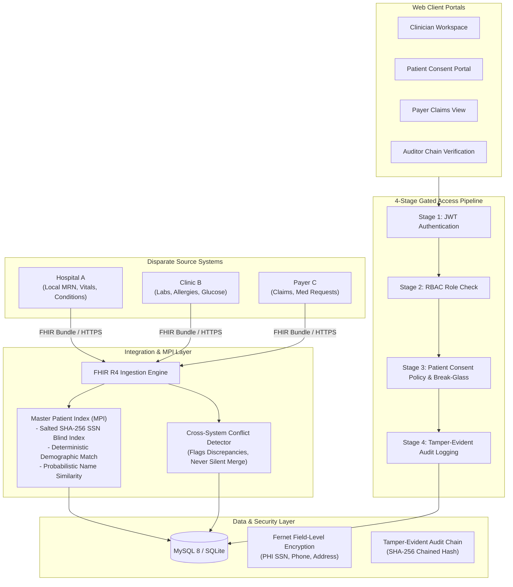
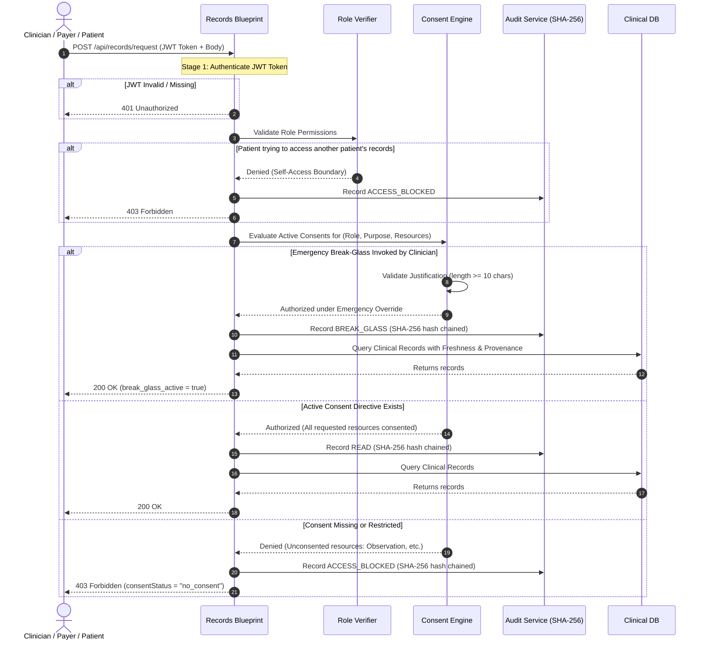

# Architecture Specification: Consent-based Healthcare Interoperability Platform (PS-013)

## 1. Executive Summary

The **Consent-based Healthcare Interoperability Platform** solves the fragmented healthcare data dilemma by securely integrating siloed clinical records (Hospital A, Clinic B, Payer C) into a unified HL7 FHIR R4 standard view while ensuring:
1. **Master Patient Index (MPI):** Multi-factor deterministic and probabilistic identity resolution.
2. **4-Stage Security Gated Reads:** Authentication $\rightarrow$ RBAC $\rightarrow$ Patient Consent $\rightarrow$ Audit Logging.
3. **Emergency Break-Glass:** Clinician emergency override with audit trail and mandatory justification.
4. **Data Provenance & Freshness Lineage:** Every record attributes `source_system`, `last_updated`, and `ingested_at`.
5. **No Silent Merging:** Discrepant data (conflicting allergies, blood types) is flagged in an open conflict registry.
6. **Tamper-Evident Audit Trail:** SHA-256 hash-chained immutable logging.

---

## 2. Core Architecture Diagram

---

## 3. The 4-Stage Security Gate Pipeline

Every read access to patient clinical records (`POST /api/records/request`) passes through four sequential gates:

---

## 4. Master Patient Index (MPI) Matching Algorithm

1. **Exact Local Source Mapping:** Look up `(source_system, local_patient_id)` in `local_patient_mappings`. If found $\rightarrow$ Match confidence: `1.0`.
2. **Salted Blind Index Matching:** Normalized SSN/National ID hashed via salted SHA-256. If match found $\rightarrow$ Match confidence: `1.0`.
3. **Exact Demographic Match:** Match on `(first_name, last_name, dob)` ignoring case and whitespace. If match found $\rightarrow$ Match confidence: `0.98`.
4. **Probabilistic Matching:** For records sharing identical DOB, calculate token-based Levenshtein/character similarity:
   $$\text{Score} = (0.45 \times \text{Sim}_{\text{first}}) + (0.55 \times \text{Sim}_{\text{last}})$$
   If $\text{Score} \ge 0.85 \rightarrow$ Link to existing Master Patient.
5. **New Identity Creation:** If none of the above match, allocate a new Master Patient ID (`MP-XXXXX`) and store Fernet-encrypted identifier and demographics.

---

## 5. Tamper-Evident SHA-256 Cryptographic Hash Chaining

The audit log functions as an append-only cryptographic chain:

$$\text{hash}_0 = \text{GENESIS\_HASH} = \text{"0000000000000000000000000000000000000000000000000000000000000000"}$$
$$\text{hash}_n = \text{SHA-256}(\text{hash}_{n-1} \,|\, \text{ts} \,|\, \text{user\_email} \,|\, \text{role} \,|\, \text{action} \,|\, \text{resource\_type} \,|\, \text{patient\_id} \,|\, \text{outcome} \,|\, \text{reason} \,|\, \text{ip})$$

Any direct unauthorized edit to past rows (via SQL update, compromised database admin, or backup alteration) causes immediate chain verification failure at `/api/audit-logs/verify`.
